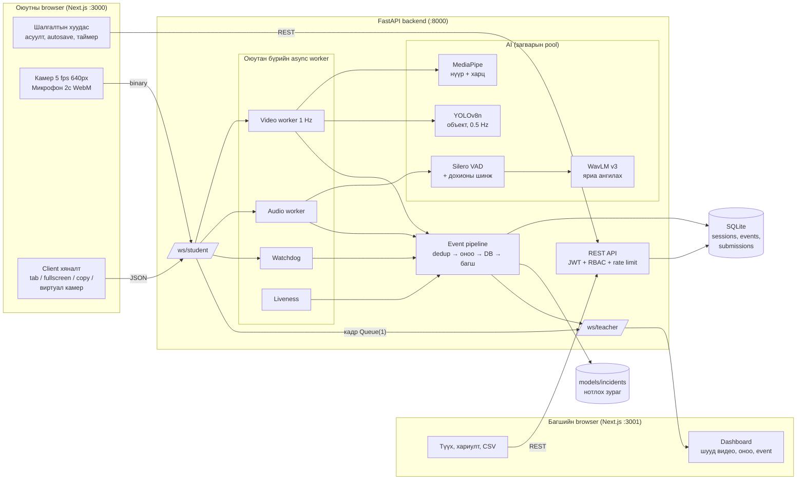
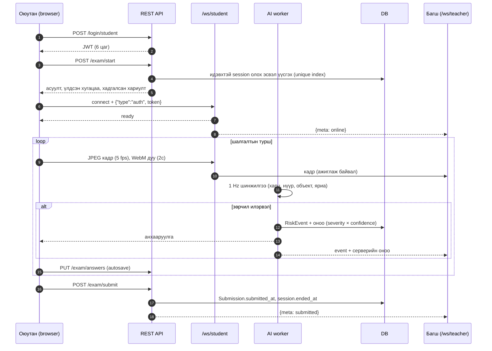
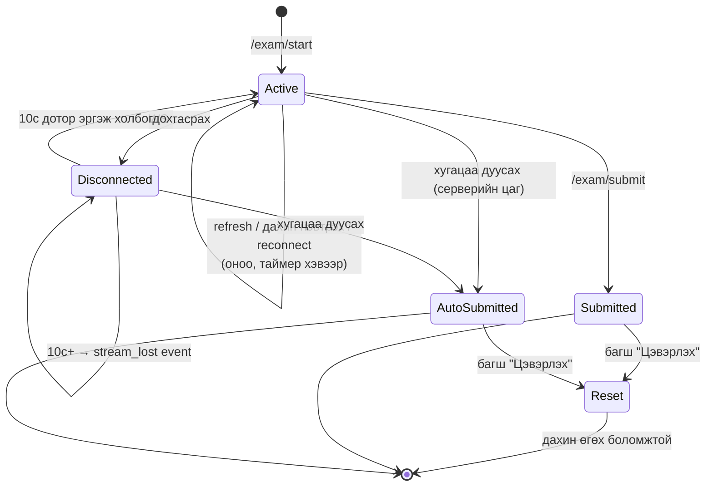
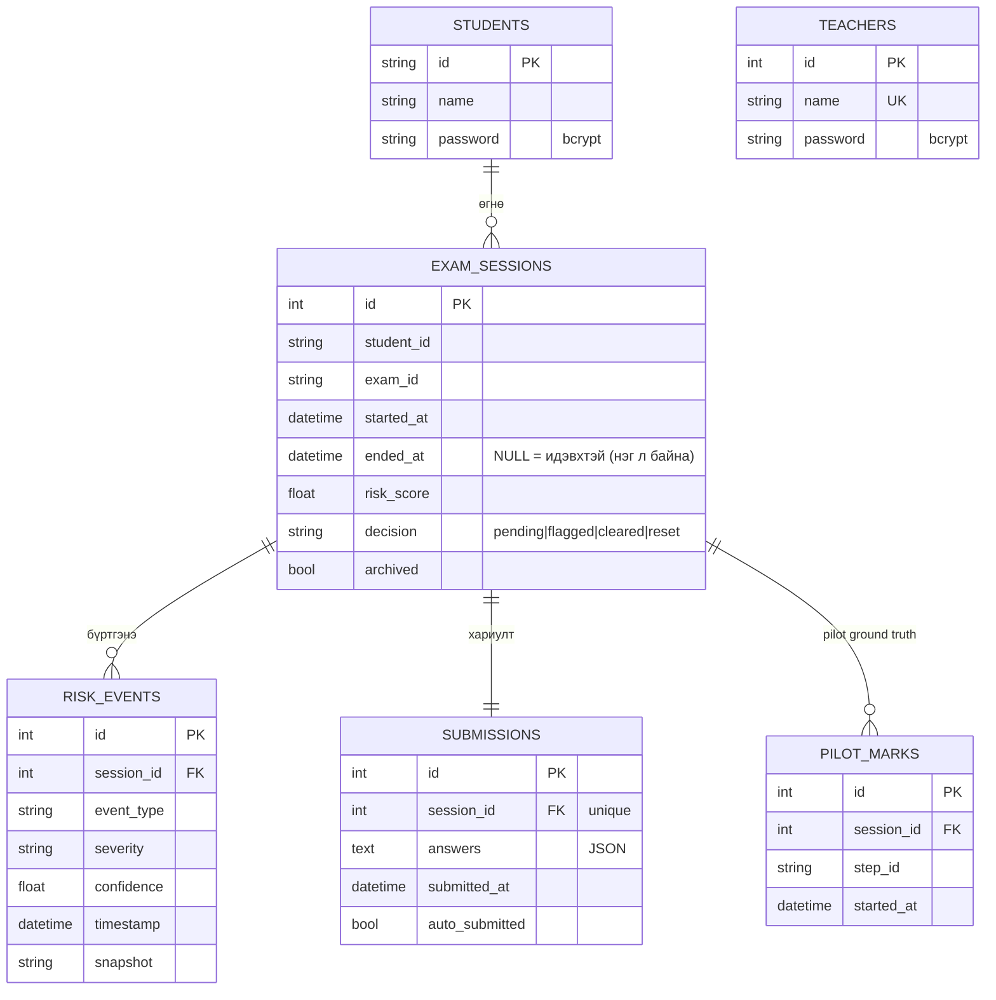

# AI Proctor — Архитектур

Диаграммууд нь Mermaid форматтай (GitHub дээр шууд зураг болж харагдана; дипломд оруулахдаа
mermaid.live-аас PNG/SVG экспортлоно).

## 1. Системийн бүрэлдэхүүн

## 2. Шалгалтын урсгал (sequence)

## 3. Session-ий төлөв

## 4. Өгөгдлийн загвар

## 5. Аюулгүй байдлын давхаргууд

| Аюул | Хамгаалалт | Байршил |
|---|---|---|
| Нэвтрэлтгүй хандалт | JWT + role (student/teacher) бүх endpoint-д | `backend/auth.py` |
| Нууц үг таах | bcrypt, IP+нэрээр 5 оролдлого, IP-ээр 20 → 5 мин түгжээ; бүртгэлгүй нэрийн хугацааг тэнцүүлэх | `backend/ratelimit.py` |
| Өөр оюутны/багшийн нэрээр WS холбогдох | student_id-г token-оос авна, багш тусдаа socket | `api/websocket.py` |
| Дахин нэвтэрч оноо/таймер reset хийх | Session зөвхөн илгээх/хугацаа дуусахад хаагдана | `exam_service.py` |
| Камер/дуу зогсоох (DevTools) | Серверийн watchdog | `_watchdog` |
| Урьдчилан бичсэн видео, зураг | Санамсаргүй liveness даалгавар | `ai/liveness.py` |
| Виртуал камер | Төхөөрөмжийн нэр шалгах (тойрч болно → liveness) | `exam/page.tsx` |
| Нотлох зургийн IDOR | Incident зураг зөвхөн багшид, path traversal шалгалт | `routes.py` |
